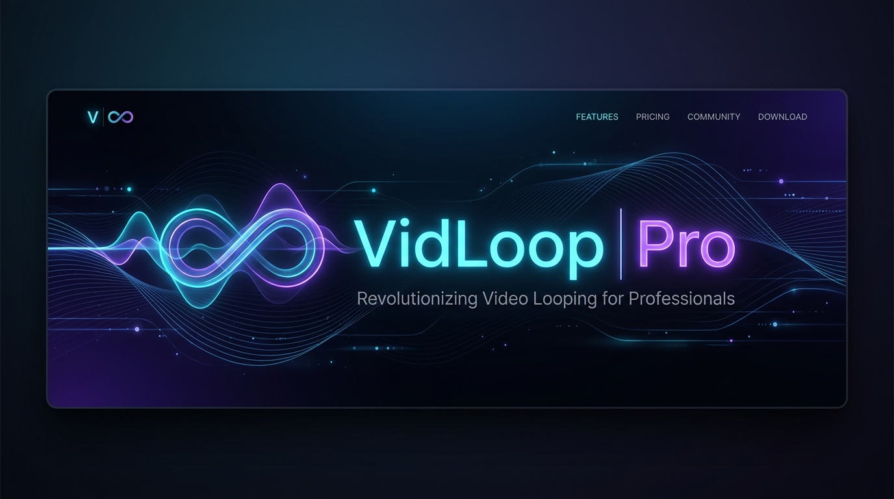
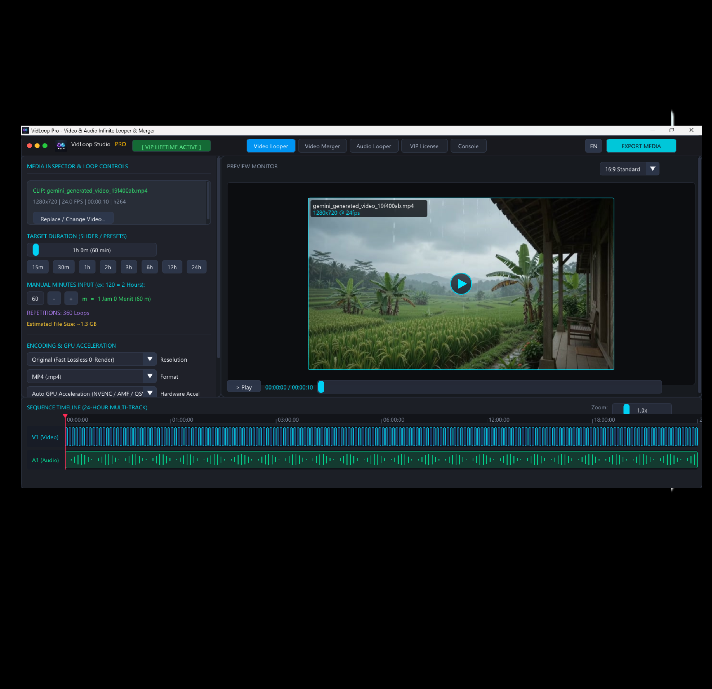
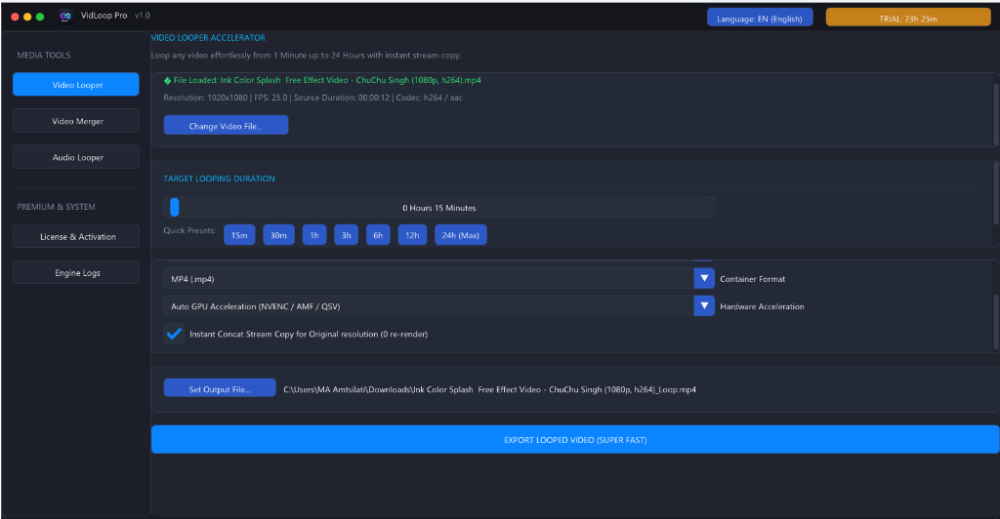

  

# 🎬 VidLoop Pro Studio v1.0
### *Infinite Video & Audio Looper and Multi-Clip Merger Suite*

[-0078D6?style=for-the-badge&logo=windows)](https://github.com/vidloopsoft/app)

 

[🌐 **Website & Landing Page Resmi**](https://vidloopsoft.github.io/app/) • [⬇️ **Download Setup_VidLoopPro.exe (27.7 MB)**](Setup_VidLoopPro.exe) • [💬 **Beli Lisensi via WhatsApp**](https://wa.me/6285641184229)

---

> [!TIP]
> ### 🎁 100% GRATIS UJI COBA 24 JAM PERTAMA (AUTO FREE TRIAL)!
> Anda dapat mengunduh dan memasang aplikasi secara gratis sekarang juga. **Masa percobaan gratis 24 jam langsung aktif otomatis tanpa syarat kartu kredit & tanpa watermark**. Anda bebas menguji seluruh fitur looping 24 jam, video merger, dan ekspor 4K sebelum memutuskan membeli lisensi seumur hidup.
>
> ➡️ [**Klik di sini untuk langsung download installer: Setup_VidLoopPro.exe (27.7 MB)**](Setup_VidLoopPro.exe)

---

## 🌟 Tentang VidLoop Pro Studio

**VidLoop Pro Studio** adalah software desktop kelas profesional berbasis **C++20 & DirectX 11** yang dirancang khusus untuk kebutuhan **looping video dan audio hingga 24 jam nonstop** serta **penggabung banyak file video (video merger)** dengan kecepatan render instan (teknologi *Lossless Direct Stream Copy*).

Dilengkapi tampilan studio modern bernuansa *Dark Matte NLE* terinspirasi dari **CapCut** dan **Adobe Premiere Pro**, monitor cinema 16:9 dengan ekstraksi frame asli, multi-track visual timeline, serta integrasi resmi ke **Windows Control Panel (`Programs and Features`)**.

---

## 📸 Tampilan Antarmuka Studio

  
  
<em>Antarmuka VidLoop Pro Studio v1.0 - CapCut & Premiere Pro Dark Studio Style</em>

 

  
  
<em>Fitur Video Merger - Penggabung Banyak Klip Video dengan Urutan Fleksibel</em>

---

## ⚡ Fitur Utama

| Fitur | Deskripsi |
| :--- | :--- |
| **🔁 Looping Hingga 24 Jam** | Rentang looping fleksibel dari 1 menit hingga 24 jam nonstop dengan kalkulator menit otomatis (contoh: `120 m = 2 Jam`). |
| **⚡ Lossless Stream Copy** | Mengekspor video 10-24 jam dalam hitungan detik tanpa render ulang CPU, tanpa kehilangan kualitas aslinya. |
| **🎬 Multi-Clip Video Merger** | Menggabungkan puluhan klip video menjadi satu file utuh dengan transisi mulus. |
| **🚀 Hardware Acceleration** | Mendukung akselerasi GPU NVIDIA NVENC, AMD AMF, dan Intel QuickSync untuk ekspor resolusi tinggi (480p, 720p, 1080p, 2K, 4K). |
| **🎛️ Preview Monitor 16:9** | Cinema Monitor dengan ekstraksi thumbnail frame asli dan visualisasi multi-track timeline V1 & A1. |
| **🛡️ Integrasi Control Panel** | Terdaftar resmi di `Programs and Features` (`appwiz.cpl`) lengkap dengan icon dan uninstaller mandiri (`Uninstall.exe`). |
| **🎁 24 Jam Free Trial** | Bebas mencoba seluruh fitur premium secara gratis selama 24 jam pertama setelah instalasi. |
| **🌐 Bilingual (ID & EN)** | Pilihan bahasa instan (Bahasa Indonesia & English) langsung di bar menu atas. |

---

## 🚀 Cara Instalasi (Pengguna Cukup 1 File Saja!)

Untuk menggunakan VidLoop Pro, Anda hanya memerlukan satu file executable setup:

1. Unduh [**`Setup_VidLoopPro.exe`**](Setup_VidLoopPro.exe) (~27.7 MB).
2. Jalankan `Setup_VidLoopPro.exe` (klik *Yes* pada dialog Administrator UAC).
3. Klik **Lanjut >** -> Tentukan lokasi instalasi (default: `C:\Program Files\VidLoop Pro`) -> Klik **Pasang Sekarang**.
4. Selesai! Icon **VidLoop Pro** langsung muncul di Desktop & Start Menu Anda dan langsung terdaftar di Windows Control Panel.

---

## 💎 Harga & Pembelian Lisensi Lifetime

Aplikasi ini dapat langsung dicoba secara **GRATIS selama 24 jam pertama**. Setelah masa percobaan habis, Anda dapat mengaktifkan lisensi permanen seumur hidup:

- 💰 **Harga**: **Rp 100.000,-** *(Untuk Indonesia)* atau **$7 USD** *(Internasional)*
- 🔒 **Tipe Lisensi**: Lifetime / Permanen Seumur Hidup (Terkunci 1 Komputer via Hardware Machine ID)
- 🚫 **Bebas Langganan**: Sekali bayar, tidak ada biaya perpanjangan bulanan/tahunan.

### Kontak Resmi Aktivasi & Metode Pembayaran:
- 📱 **WhatsApp & QRIS**: [+6285641184229](https://wa.me/6285641184229?text=Halo%20Zainu%20El%20Maarif,%20saya%20ingin%20membeli%20lisensi%20VidLoop%20Pro) *(Respon Cepat, Bank BCA / BRI / Mandiri & QRIS)*
- 💙 **DANA**: `0856-4118-4229` (a.n. Zainu El Maarif)
- 💚 **GoPay**: `0856-4118-4229` (a.n. Zainu El Maarif)
- 🧡 **ShopeePay**: `0856-4118-4229` (a.n. Zainu El Maarif)
- 💳 **PayPal**: `zainuelflash9@gmail.com` *($7.00 USD / Rp 100.000)*
- ✈️ **Telegram**: [@Zainuelmaarif](https://t.me/Zainuelmaarif) *(Support 24/7)*
- 📧 **Email**: [zainuelmaarif@gmail.com](mailto:zainuelmaarif@gmail.com)

### Langkah Aktivasi:
1. Buka aplikasi **VidLoop Pro**.
2. Klik tombol **Aktivasi Lisensi** untuk melihat dan menyalin **Machine ID** komputer Anda.
3. Kirimkan Machine ID ke WhatsApp atau Telegram pengembang.
4. Masukkan **Kunci Lisensi** yang Anda terima -> Klik **Aktifkan**. Lisensi langsung aktif permanen selamanya!

---

## 🧹 Cara Pencopotan Pemasangan (Uninstall)

VidLoop Pro dapat dicopot pemasangannya kapan saja dengan bersih dan mudah:
1. Buka **Control Panel** -> Pilih **Programs and Features** (atau buka menu Windows **Settings > Apps > Installed apps**).
2. Cari **VidLoop Pro v1.0** -> Klik tombol **Uninstall**.
3. Seluruh shortcut di Desktop, Start Menu, folder instalasi, serta entri registri akan dihapus bersih tanpa residu.

---

**Dikembangkan dengan bangga oleh Zainu El Maarif**  
*Hak Cipta &copy; 2026 VidLoop Pro Studio. All Rights Reserved.*

